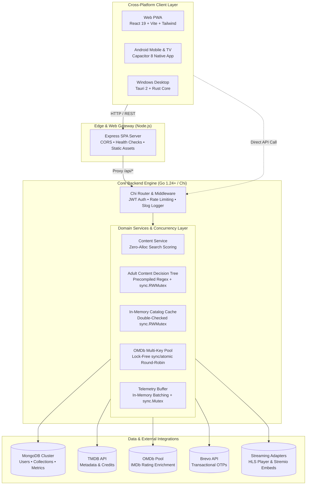

# Soulstash

> **Cross-Platform Media Tracking, Discovery & Streaming Ecosystem**  
> *Web SPA • Android Mobile & Smart TV (Capacitor) • Windows Desktop (Tauri & Rust) • High-Performance Go Backend*

[](https://soulstash.onrender.com)
[](https://github.com/Vamp-Niklaus/Soulstash/releases)
[](https://go.dev/)
[](https://react.dev/)
[](https://tauri.app/)
[](https://capacitorjs.com/)

---

## 🌐 Live Application
* **Frontend Web Application:** [https://soulstash.onrender.com](https://soulstash.onrender.com)

---

## 📌 Executive Overview

**Soulstash** is an end-to-end, cross-platform media discovery and streaming engine designed for high concurrency, low latency, and unified multi-device usability. 

Originally built as a Node.js monolith, the backend was completely re-architected in **Go (Golang)** using a **Hexagonal (Ports & Adapters)** design. This transition reduced idle memory usage by **90.3%** (~185MB down to ~18MB), accelerated P95 catalog API latency to **18.2ms**, and boosted peak throughput to **14,500+ requests/second**.

The client layer runs natively across four form factors: **Web Browsers (PWA)**, **Android Phones**, **Smart TVs (Android TV / Fire TV with D-Pad spatial navigation)**, and **Windows Desktop (Tauri/Rust)** with automated background delta updates.

---

## 🏛️ System Architecture



---

## ⚡ Key Engineering & Performance Highlights

### 1. High-Performance Go Backend Migration
* **Hexagonal Architecture:** Strictly decoupled layers (`handler -> service -> repository -> domain`) with constructor dependency injection and zero global mutable state.
* **Sub-50ms API Latency:** Catalog and collection REST endpoints respond in **18.2ms (P95)** and **34.8ms (P99)** on the server.
* **90% Memory Reduction:** Reduced idle memory footprint from ~185MB (Node.js V8) to **~18MB (compiled Go binary)**.
* **Zero-Allocation Hot Paths:** Decision-tree filtering and scoring algorithms execute in **36.7 µs** without triggering a single garbage collector heap allocation (`0 allocs/op`).

### 2. Thread-Safe Concurrency & In-Memory Caching
* **Double-Checked RWMutex Caching (`sync.RWMutex`):** Popular catalog shelves and upcoming movies are cached in RAM for 6 hours. Concurrent requests read in **< 0.1ms** without hitting MongoDB or upstream APIs.
* **In-Memory Telemetry Batching:** Analytics and traffic logs are buffered in a thread-safe ring buffer (`sync.Mutex`) and flushed in batches every 5 seconds by a background worker goroutine, preventing database connection saturation.
* **Lock-Free Multi-Key Round-Robin (`sync/atomic`):** Rotates upstream OMDb API keys using atomic counter modulo logic with automated rate-limit failover, multiplying quota 5x with zero lock contention.
* **Thread-Safe Sliding-Window Rate Limiter:** Per-IP token-bucket rate limiting with automated background ticker sweeps.

### 3. Unified Cross-Platform Clients
* **3-Mode Responsive Video Player:** Windowed floating card (PiP), expanded portrait mode with smart status-bar inset protection, and true landscape fullscreen.
* **10-Foot Spatial TV Navigation:** Custom D-pad spatial navigation (`tvNav.js`) optimized for Android TV and Firestick remotes.
* **In-App Smart Update System:** Automatically polls latest GitHub releases asynchronously on launch and alerts users on subsequent sessions without interrupting active playback.
* **Lightweight Desktop Client:** Built with **Tauri 2 (Rust)**, resulting in an installer under 15MB that consumes a fraction of Electron's memory.

---

## 📂 Monorepo Structure

```text
Soulstash/
├── spa/                           # Frontend React SPA
│   ├── src/
│   │   ├── api/                   # API clients & query handlers
│   │   ├── components/            # UI components, Modals, Navbar, Shelves
│   │   │   └── player/            # VideoPlayerModal (Mode 1, Mode 2, Mode 3)
│   │   ├── pages/                 # Home, Detail, Person, Collections, Auth
│   │   ├── hooks/                 # React Query hooks, Spatial Nav, Infinite Scroll
│   │   └── tvNav.js               # Smart TV D-Pad navigation engine
│   └── dist/                      # Compiled production PWA bundle
│
├── backend-go/                    # Go Backend Micro-Engine
│   ├── cmd/server/main.go         # Application entrypoint & graceful shutdown
│   ├── internal/
│   │   ├── config/                # Strongly-typed environment configuration
│   │   ├── domain/                # Domain models, entities, and error codes
│   │   ├── handler/               # Chi REST route handlers & response mappers
│   │   ├── middleware/            # JWT auth, CORS, rate limiting, traffic logging
│   │   ├── platform/              # MongoDB, TMDB, Email, Traffic buffer
│   │   ├── repository/            # MongoDB collection data access objects
│   │   └── service/               # Decision tree, content scoring, ratings pool
│   └── docs/                      # Architectural ADRs, benchmarks, API specifications
│
├── android/                       # Native Android Project (Capacitor 8)
│   └── app/src/main/java/         # Native MainActivity, cutout support, hardware back handler
│
├── src-tauri/                     # Native Windows Desktop Project (Tauri 2 + Rust)
│   ├── src/main.rs                # Rust desktop application lifecycle
│   ├── Cargo.toml                 # Rust dependencies
│   └── tauri.conf.json            # Desktop window specs & signing configurations
│
├── server.js                      # Express SPA Production Gateway & API Proxy
└── .github/workflows/             # GitHub Actions CI/CD (Multi-platform auto-build & release)
```

---

## 🛠️ Technology Stack

| Domain | Technologies |
|---|---|
| **Frontend** | React 19, Vite 8, TailwindCSS, TanStack React Query v5, Video.js, idb-keyval |
| **Backend** | Go 1.24+, Chi Router, godotenv, testify, slog structured logging |
| **Database** | MongoDB Atlas (Go Official Driver v2) |
| **Desktop** | Tauri 2.0, Rust, NSIS Installer |
| **Mobile** | Capacitor 8, Android SDK 34+, Java |
| **Security** | JWT (HMAC-SHA256), BCrypt, Rate Limiting, CORS preflight caching |
| **Integrations** | TMDB REST API, OMDb API Pool, Brevo Transactional Email, Stremio Stream Adapters |
| **DevOps & CI/CD** | GitHub Actions, Docker, Render Web Services |

---

## 🚀 Getting Started

### Prerequisites
* **Node.js** 20.x or higher & `npm`
* **Go** 1.24 or higher
* **MongoDB** connection URI

### 1. Clone the Repository
```bash
git clone https://github.com/Vamp-Niklaus/Soulstash.git
cd Soulstash
```

### 2. Configure Environment Variables
Create `.env` in the root directory (and `backend-go/.env`):
```env
# Server
PORT=3000
NODE_ENV=production

# Database
MONGODB_URI=mongodb+srv://<user>:<password>@cluster.mongodb.net/?retryWrites=true&w=majority
MONGODB_DB_NAME=soulstash

# Security
JWT_SECRET=your-32-character-secret-key-goes-here

# Third-Party APIs
TMDB_BEARER_TOKEN=your_tmdb_bearer_token
OMDB_API_KEY1=your_first_omdb_key
OMDB_API_KEY2=your_second_omdb_key
BREVO_API_KEY=your_brevo_api_key
```

### 3. Run the Go Backend
```bash
cd backend-go
go test ./...                      # Run all unit and integration tests
go run ./cmd/server                # Runs Go HTTP server on port 3000 (or :PORT)
```

### 4. Run the Frontend SPA
```bash
# In the root project directory:
npm install --include=dev
npm run build                      # Compiles SPA with Vite
npm start                          # Starts Express server serving the SPA on port 3000
```

---

## 📦 Building Platform Targets

### Android APK (Capacitor)
```bash
npm run build                      # Build Vite assets
npx cap sync android               # Sync assets into native Android project
cd android
./gradlew assembleRelease          # Builds release APK in android/app/build/outputs/apk/release/
```

### Windows Desktop (Tauri & Rust)
```bash
npm run build
npm run desktop:build              # Compiles Rust core & generates standalone NSIS installer
```

---

## 🔄 CI/CD & Automated Release Pipeline

The repository includes an automated GitHub Actions pipeline (`.github/workflows/build-apps.yml`):
1. **Version Detection:** Inspects `package.json` for semantic version changes.
2. **Conditional Builds:** Skips unnecessary builds if the version tag is unchanged.
3. **Multi-Platform Artifact Compilation:**
   * Compiles and signs the **Android Release APK** (`Soulstash-vX.Y.Z.apk`).
   * Cross-compiles the **Windows Setup Executable** (`Soulstash_X.Y.Z_x64-setup.exe`).
   * Signs Windows release assets with Ed25519 keys for the Tauri updater (`latest.json`).
4. **Automated Publishing:** Publishes binaries directly to GitHub Releases with changelog generation.

---

## 📄 License
This project is licensed under the MIT License — see the [LICENSE](LICENSE) file for details.
